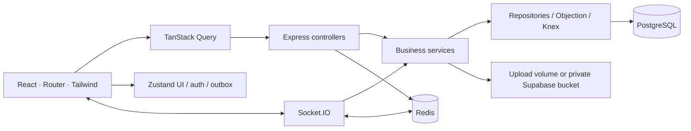

# Architecture

## Boundaries

PulseChat is a JavaScript npm workspace with a Vite/React client and an Express 5 modular monolith. Socket.IO and REST invoke the same conversation/message services. Objection.js provides a model boundary for users; Knex provides parameterized PostgreSQL access and migrations throughout the repositories. This keeps SQL, cursor predicates, and transactional concurrency explicit without introducing TypeScript or generated client code.

## Frontend

TanStack Query owns server state: conversations, messages, members, search, files, and notifications. Zustand owns session credentials in memory, interface preferences, presence/typing, delivery acknowledgements, and an in-memory outbox. Only the theme preference is stored in localStorage. Failed sends survive query refetches but deliberately do not survive a full page reload.

Each send creates a UUID `client_message_id`. The UI renders an optimistic row and reconciles either the acknowledgement or incoming event with the same key. Duplicate events replace existing rows. Failed or uncertain sends keep the key for safe retries. Refresh requests are single-flight within a tab and use Web Locks across supported browser tabs. Tokens never go in a URL or localStorage. File tickets are short-lived bearer URLs and are stripped from application request logs.

Native `<dialog>` provides modal focus containment and Escape behavior. React text rendering avoids executing message HTML. The composer supports Enter/Shift+Enter and input-method composition; buttons have accessible labels. Mobile navigation and details panels overlay the workspace at narrow widths. Reduced-motion settings are respected.

## Persistence and concurrency

The migration creates users, sessions, hashed refresh tokens, conversations, memberships, messages, reactions, attachments, notifications, and audit logs. Foreign keys protect relationships, and composite uniqueness protects membership, reactions, direct-conversation pairs, and sender/client-message keys.

Message writes acquire a conversation row lock, recheck membership within the transaction, and acquire an advisory lock on the sender/client-message key. Conversation member changes use the same conversation lock. A message, attachment association, and recipient notifications commit together. Serializing writes per conversation makes membership changes predictable and avoids lock-upgrade deadlocks; unrelated conversations can write concurrently. A unique constraint is the final idempotency boundary.

Message timestamps use millisecond precision. Cursors encode `(created_at, id)` and use matching tuple predicates and ordering, so equal timestamps do not skip records. History uses an indexed descending seek, never OFFSET. Read watermarks advance monotonically and use the same timestamp/UUID ordering. The UI shows “read” when at least one other member's durable watermark covers the message.

Search uses PostgreSQL English full-text search with a GIN index and an inner membership join. The current result limit is 50. Conversation lists compute unread counts from durable read watermarks; notifications are persisted with messages and suppress new entries during a per-member mute period.

## Authentication and authorization

Passwords use bcrypt with cost 12; registration rejects inputs exceeding bcrypt's 72-byte limit. Access JWTs use explicit HS256, issuer/audience, subject, session ID, and a ten-minute expiry. Every protected HTTP request and socket event verifies the session is unrevoked. Sockets are disconnected at token expiry and reauthenticate after refresh.

Thirty-day refresh credentials are random opaque tokens, stored only as SHA-256 digests in PostgreSQL. Rotation locks the old token row, marks it used, and issues a replacement in the same session. Reuse revokes the session family, including connected sockets. Logout revokes the current session and clears the cookie. Cookies are HTTP-only, SameSite=Strict, scoped to `/api/auth`, and Secure when configured for HTTPS.

Public channel metadata is discoverable, but membership is required to read history or interact. Only owners/admins manage members/settings; owners cannot be removed; direct conversation membership is immutable. Only the sender edits message bodies. Senders and conversation admins may delete messages. All members may pin and react. Realtime fan-out resolves current authorized user rooms rather than relying solely on potentially stale conversation-room membership.

## Redis and availability

Redis is mandatory, not an in-memory fallback. It stores expiring per-user socket presence, profile-cache entries, HTTP/socket rate counters, the maintenance lock, and Socket.IO adapter traffic. Presence supports multiple sockets per user and removes entries older than 75 seconds; keys expire after 90 seconds. Typing expires in the client after four seconds. These are approximate ephemeral signals, not durable activity records.

`/health` reports process liveness. `/ready` checks both data dependencies and returns 503 when either is unavailable. Database and Redis startup checks retry with bounded backoff. Request errors are centralized and redacted. Shutdown stops scheduled work, closes sockets, drains presence cleanup, closes adapter clients, and ends database/Redis connections, with a ten-second hard deadline.

## Files and deployment

The upload service reserves metadata after membership validation, issues a five-minute signed upload ticket, verifies exact size and detected MIME type, and writes under a generated opaque UUID. `STORAGE_DRIVER=local` uses a durable volume; `supabase` uses a private bucket through the server-only SDK. Maximum size is 10 MiB, maximum five attachments per message. SVG/HTML are not accepted; image formats, PDF, and UTF-8 plain text are allowed. Files are associated with a message atomically and cannot be reused by a different user or conversation.

Download tickets expire after 60 seconds. Every download rechecks current membership and message visibility before reading local or remote bytes. Documents download as attachments with restrictive headers; validated raster images may be displayed inline. Cleanup removes abandoned reservations and orphaned files after a grace period. Local storage requires a shared persistent volume across replicas. The Supabase adapter instead stores bytes outside the application host and preserves them across redeploys. Downloads are buffered up to the upload size limit and pass through Express, consuming both storage egress and app bandwidth.

`SERVE_FRONTEND=true` serves the built React application directly from Express for one-service hosting. API and socket paths remain separate from the SPA fallback. The frontend and backend then share an origin, preserving secure refresh cookies and relative URLs. See the free deployment walkthrough for Render, Supabase, and Upstash. Migration 003 enables RLS without public policies on app tables. The backend uses the table-owning connection and retains service-level membership checks; anonymous generated database APIs must remain disabled. A future non-owner runtime role needs explicit grants and an RLS design.

Nginx serves the Vite build and proxies `/api` and `/socket.io`. PostgreSQL/Redis health checks gate backend startup; backend readiness gates frontend startup. Containers run the backend as a non-root user. Use an external HTTPS ingress and secrets management for a real deployment. Scale polling clients with sticky routing; the Redis adapter alone does not provide that routing. PostgreSQL backups and uploaded-file backups must be managed together.
