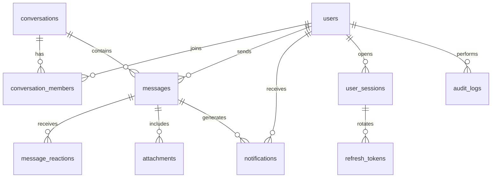

# Explore how PulseChat works

Use the **local demo workspace** for this walkthrough. PostgreSQL is the durable record of users, sessions, conversations, messages, read receipts, and notifications. Redis holds fast, temporary state and distributes events between backend processes. The browser displays database-backed state through REST and updates it through Socket.IO events.

## 1. Connect to PostgreSQL

For the standard Docker setup:

```sh
docker compose exec postgres psql -U pulsechat -d pulsechat
```

Useful `psql` commands:

```text
\dt                   list tables
\d messages           inspect message columns, constraints, and indexes
\d conversation_members
\x auto               expand wide rows automatically
\timing on            show query timing
\q                    exit
```

You can also use pgAdmin, DBeaver, or TablePlus with this local connection:

| Setting  | Value                                    |
| -------- | ---------------------------------------- |
| Host     | `127.0.0.1`                              |
| Port     | `5432`                                   |
| Database | `pulsechat`                              |
| Username | `pulsechat`                              |
| Password | `pulsechat_local`, unless you changed it |

These credentials describe the local demo database, not production. PostgreSQL is published only on the host loopback interface by Compose.

**On the current authoring machine:** Docker is not installed. PostgreSQL and Redis were started using `node scripts/local-infra.js`, with the same host, port, database, and credentials above. The helper keeps data under `.local/postgres`. The bundled PostgreSQL package does not include the interactive `psql` client, so use a database GUI or the included read-only Node inspector:

```sh
npm run db:inspect
npm run db:inspect -- messages
npm run db:inspect -- schema
npm run redis:inspect
```

The inspectors use `.env`, perform reads only, and avoid printing passwords, token values, cached profile content, or message bodies. They are intended for the local project. `db:inspect messages` shows recent message IDs, conversations, senders, timestamps, lengths, versions, and deletion state. The default view shows entity counts and recent conversation names.

## 2. Understand the relationships



`conversation_members` is the authorization table. A user must have a row for a conversation before they can read its history, send a message, react, or fetch its files. The same membership rules run for REST requests and socket events. `role` controls owner/admin actions.

Inspect the directory without selecting password hashes:

```sql
SELECT id, username, display_name, status, last_seen_at
FROM users ORDER BY created_at;

SELECT c.name, c.type, c.is_private, u.username, cm.role,
       cm.last_read_message_id, cm.last_read_at
FROM conversation_members cm
JOIN conversations c ON c.id = cm.conversation_id
JOIN users u ON u.id = cm.user_id
ORDER BY c.name, u.username;
```

The user's `status` column is their preference, such as available or away. Actual online/offline presence also requires a live Redis socket entry. An `online` preference alone does not mean the user is currently connected.

## 3. Follow a message end to end

1. Sign in as `alex@pulsechat.demo` using `SEED_PASSWORD`.
2. Open a channel and send a recognizable message, such as `Learning how PulseChat works`.
3. Inspect the newest database records:

```sql
SELECT m.id, COALESCE(c.name, '(direct)') AS conversation,
       u.username AS sender, m.body, m.client_message_id,
       m.version, m.created_at
FROM messages m
JOIN conversations c ON c.id = m.conversation_id
JOIN users u ON u.id = m.sender_id
ORDER BY m.created_at DESC, m.id DESC
LIMIT 10;
```

The path is:

```text
Composer creates a UUID retry key
  → optimistic row appears in the browser
  → message:send reaches the authenticated Socket.IO handler
  → service validates membership and locks the conversation
  → transaction inserts message + attachments + recipient notifications
  → PostgreSQL commits
  → Redis adapter distributes message:new to authorized user rooms
  → acknowledgement replaces the optimistic row with the persisted record
```

The server-generated `id` identifies the persisted record. The client-generated `client_message_id` identifies the logical send attempt. A unique `(sender_id, client_message_id)` constraint prevents retries from storing the same message twice. The integration test suite deliberately sends the same key concurrently and asserts that only one record exists.

Edit that message in the UI, then repeat the query:

```sql
SELECT id, body, version, edited_at, deleted_at, updated_at
FROM messages ORDER BY created_at DESC, id DESC LIMIT 5;
```

Edits increment the version; the frontend ignores older event versions. Deletion is a tombstone: `deleted_at` is set and the body is cleared, preserving history/cursor structure. A conversation deletion is different: it permanently cascades related rows. Do not use destructive queries while exploring.

## 4. Observe notifications and read receipts

Use two separate browser profiles or an incognito window, since ordinary tabs share the same refresh cookie. Sign the second browser in as `maya@pulsechat.demo`. Open `general` in one browser and a different channel in the other, then send a message.

```sql
SELECT u.username, c.name, n.title, n.message_id, n.read_at, n.created_at
FROM notifications n
JOIN users u ON u.id = n.user_id
JOIN conversations c ON c.id = n.conversation_id
ORDER BY n.created_at DESC LIMIT 15;

SELECT u.username, cm.last_read_message_id, cm.last_read_at, cm.muted_until
FROM conversation_members cm
JOIN users u ON u.id = cm.user_id
JOIN conversations c ON c.id = cm.conversation_id
WHERE c.slug = 'general';
```

When the second browser opens the channel and reaches the bottom while visible, its watermark advances. Channel unread counts come from messages newer than that watermark, excluding the user's own and deleted messages. Notification read state is separate: “Mark all read” clears activity entries without pretending that every conversation was read.

“Delivered” is a temporary client acknowledgement, so it has no database column. “Read” is durable through `conversation_members`. The UI's read label means at least one other member has read through that message.

## 5. Inspect reactions, replies, and files

React to a message, reply to it, and attach a small text file or image in the UI:

```sql
SELECT u.username, r.message_id, r.emoji, r.created_at
FROM message_reactions r JOIN users u ON u.id = r.user_id
ORDER BY r.created_at DESC LIMIT 10;

SELECT id, reply_to_id, body FROM messages
WHERE reply_to_id IS NOT NULL ORDER BY created_at DESC LIMIT 10;

SELECT id, filename, mime_type, size, message_id, uploaded_at
FROM attachments ORDER BY created_at DESC LIMIT 10;
```

PostgreSQL stores file metadata and ownership. The bytes live in the upload volume (`backend/uploads` in host development), or in the private Supabase bucket when `STORAGE_DRIVER=supabase`. The file endpoint checks the signed ticket, current membership, and message visibility before serving bytes. There is no publicly exposed static uploads directory.

## 6. Understand authentication records

Inspect session metadata without displaying credentials or hashes:

```sql
SELECT u.username, s.id AS session_id, s.created_at, s.expires_at, s.revoked_at
FROM user_sessions s JOIN users u ON u.id = s.user_id
ORDER BY s.created_at DESC LIMIT 10;

SELECT session_id, count(*) AS issued_refresh_tokens,
       count(*) FILTER (WHERE used_at IS NOT NULL) AS rotated_tokens
FROM refresh_tokens GROUP BY session_id;

SELECT action, resource_id, created_at
FROM audit_logs ORDER BY id DESC LIMIT 15;
```

Reloading a signed-in page rotates the refresh token: one token gets `used_at`, and a new hashed token row is created in the same session. Logout sets `revoked_at`; it does not need to delete historical rows. Reusing an old refresh token revokes that session family. Password hashes and token digests are sensitive internal data; neither is needed to understand this flow.

## 7. Inspect Redis

Docker:

```sh
docker compose exec redis redis-cli
```

On this machine, the locally compiled binary is also available:

```sh
.local/redis-7.4.7/src/redis-cli
```

Inside the Redis CLI:

```text
PING
SCAN 0 MATCH pulse:* COUNT 50
```

`SCAN` returns a cursor followed by keys; repeat it with the returned cursor until it returns `0`. Avoid `KEYS *` on a busy production database.

| Key pattern                                   | Why it exists                                     | Useful inspection                             |
| --------------------------------------------- | ------------------------------------------------- | --------------------------------------------- |
| `pulse:presence:<user UUID>`                  | Sorted set of socket IDs scored by heartbeat time | `ZCARD <key>`, `TTL <key>`                    |
| `pulse:user:<user UUID>`                      | Cached safe profile for presence, 60-second TTL   | `TTL <key>`; no need to print profile content |
| `pulse:limit:auth:*`                          | Shared HTTP authentication rate limit             | `TYPE <key>`, `PTTL <key>`                    |
| `pulse:limit:messages:*`                      | Shared message HTTP rate limit                    | `PTTL <key>`                                  |
| `pulse:socket-limit:<user UUID>:message:send` | Per-user socket send counter                      | `GET <key>`, `TTL <key>`                      |
| `pulse:cleanup:lock`                          | Short-lived maintenance coordination lock         | `TTL <key>`                                   |

Socket.IO adapter messages use Redis **Pub/Sub**, not persistent message keys. Inspect channel names with `PUBSUB CHANNELS socket.io*`. PostgreSQL stores chat history; Redis can be restarted without losing that history. Do not run `FLUSHALL` or publish into adapter channels while exploring. Tests use Redis database 15; the app uses database 0 by default.

## 8. See why the history index matters

```sql
SELECT indexname, indexdef FROM pg_indexes WHERE tablename = 'messages';

EXPLAIN (ANALYZE, BUFFERS)
SELECT id, body, created_at
FROM messages
WHERE conversation_id = (SELECT id FROM conversations WHERE slug = 'general')
ORDER BY created_at DESC, id DESC
LIMIT 30;
```

A small seeded table may use a sequential scan because PostgreSQL estimates it is cheaper. At larger sizes, the composite conversation/timestamp/ID index supports the seek. The next page adds a tuple comparison `(created_at, id) < (...)` instead of scanning and discarding an OFFSET.

## 9. Check services and run the proofs

Host development:

```sh
curl http://localhost:4000/health
curl http://localhost:4000/ready
npm run test:integration
```

Full Docker stack:

```sh
docker compose ps
docker compose logs -f backend
docker compose exec backend node -e "fetch('http://localhost:4000/ready').then(r=>r.json()).then(console.log)"
```

Liveness means the process is running. Readiness means PostgreSQL and Redis answer checks. Logs include request IDs, routes, statuses, and timing, while omitting tokens, passwords, query-string tickets, and request bodies.

For the clearest learning sequence: **send a message → inspect its row → open it in another browser → inspect the read watermark → edit/react → inspect the related rows → reload → inspect refresh-token rotation → sign out → inspect session revocation.**
